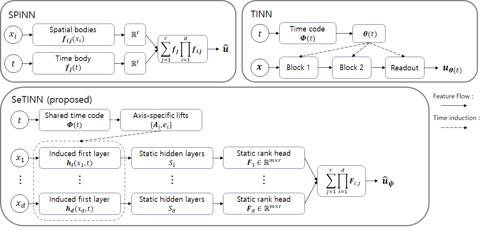

# SeTINNs: Separable Time-Induced Neural Networks for Multidimensional Time-Dependent PDEs

Sehong Park, Byung-Sun Won, Uiwon Hwang, Daejin Choi, Jaeho Hwang&dagger;\
Ewha Womans University &nbsp;·&nbsp; &dagger;Corresponding author

JAX implementation of SeTINN and of the two baselines it is compared with,
SPINN and TINN.

## Architecture overview



* **SPINN** factors the solution into one MLP per coordinate, time included,
  combined by a rank-$r$ product.
* **TINN** generates every layer of a spatial network from a time code $\Phi(t)$.
* **SeTINN** keeps SPINN's spatial bodies and lets one shared time code induce
  only the first layer of each body, $\theta_i(t) = A_i\Phi(t) + c_i$. The
  deeper layers and the rank head stay static, so every network evaluation is
  still one-dimensional, and the models are small enough for
  Levenberg–Marquardt.

## Environment

Python 3.11 or 3.12.

```bash
python -m venv .venv
source .venv/bin/activate
pip install -r requirements.txt
```

For GPU runs, install a JAX GPU build first and then `requirements-gpu.txt`.
The paper's runs used JAX 0.6.2 on one NVIDIA RTX 6000 Ada (48 GB). Use JAX
0.6.2 to reproduce them: the initial parameters of a seed depend on JAX's
random-number scheme, which changed in JAX 0.5 (`jax_threefry_partitionable`).

## Training

```bash
python train.py --problem kg2d --profile tensor_50sq_x_50 --t-max 10 \
    --arm setinn --layer-dims 1,10,10,1 --rank 5 \
    --hours 6 --evals 6 --out results/kg2d_setinn
```

| Option | |
|---|---|
| `--problem` | `kg2d`, `nstg` (Taylor–Green, Re = 1/`--nu`), `kg3d`, `ns3d` |
| `--arm` | `tinn`, `spinn`, `setinn` (first layer induced) or `setinnall` (every layer) |
| `--profile` | tensor grid: `tensor_50sq_x_50` or `tensor_100sq_x_100` for the 2-D problems, `tensor_16cubed_x_16` or `tensor_25cubed_x_25` for the 3-D ones |
| `--layer-dims`, `--rank` | one axis body and the separation rank (SPINN, SeTINN) |
| `--optimizer` | `lm` (default) or `adam` |
| `--hours`, `--evals` | wall-clock budget per seed, and the number of evaluations during it |
| `--seeds` | default `997 998 999` |

Every method gets the same wall-clock budget, not the same number of steps: a
short calibration measures the time per step on the GPU, and the number of
steps that fits in `--hours` is fixed before training starts.
`--skip-finished` leaves finished runs alone.

Each seed writes `<out>/<method id>/seed_<n>/`:

| File | |
|---|---|
| `protocol.json` | every setting of the run, with the expected parameter count |
| `manifest.json` | hashes of the protocol, collocation points and source files; step counts and timing |
| `trace.json` | loss and errors at each evaluation |
| `evaluation.npz` | prediction, reference and error on the evaluation grid |
| `parameters.npy`, `loss_history.npy`, `lm_state.json` / `adam_state.npz` | final parameters, loss at every step, optimizer state |
| `training.log` | the console output |

| Problem | |
|---|---|
| `kg2d` | (2+1)-D Klein–Gordon, $u = \tanh((2+2.5t)(x-0.5))\sin(\pi y)$ on $[0,1]^2$ |
| `nstg` | (2+1)-D Taylor–Green vortex on $[0,2\pi]^2$ |
| `kg3d` | (3+1)-D Klein–Gordon, $u = (x+y+z)\cos 2t + xyz\sin 2t$ on $[-1,1]^3\times[0,10]$ |
| `ns3d` | (3+1)-D Navier–Stokes in vorticity form, Taylor–Green vortex on $[0,2\pi]^3\times[0,5]$ |

## Reproducing the paper

```bash
bash scripts/run_paper.sh --dry-run    # the 96 runs: 32 settings x 3 seeds
bash scripts/run_paper.sh 0 1 2 3      # one worker per listed GPU
python tools/sweep_status.py           # progress and seed-averaged errors per evaluation
```

| Paper | Grids | Arms |
|---|---|---|
| Section 4 tables | KG2D 50³ (T = 10), Taylor–Green Re 40 and Re 200 at 50³, KG3D 16⁴, NS3D 16⁴ | TINN; SPINN, [1,64,64,64,1], r = 32, Adam; SeTINN, [1,10,10,1], r = 5 |
| Collocation ablation, appendix | KG2D and Taylor–Green at 100³, KG3D and NS3D at 25⁴ | the same three |
| Layer ablation | KG2D 50³ | `setinnall`, r = 5 |
| Rank ablation | KG2D 50³ | `setinn`, r = 32 |

Step counts depend on the GPU, because the budget is wall clock.

## Code

```
train.py                  one architecture on one PDE under a wall-clock budget
setinn/models/            tinn.py, spinn.py, setinn.py; phi.py is the time code
setinn/problems/          one module per PDE: sampling, residuals, evaluation
setinn/training/          lm.py (Levenberg–Marquardt), adam.py
setinn/protocol.py        the settings of a run, sealed and hashed
scripts/run_paper.sh      every run in the paper
tools/sweep_status.py     progress of a sweep and its errors averaged over seeds
```

On a tensor grid the interior residual of SPINN and SeTINN is evaluated per
axis point rather than per grid point (`setinn/problems/separable.py`), and LM
accumulates $J^\top J$ and $J^\top r$ in chunks without forming $J$
(`setinn/problems/normal_equations.py`).

## Citation

```bibtex
@misc{park2026setinns,
  title  = {{SeTINNs}: Separable Time-Induced Neural Networks for Multidimensional Time-Dependent {PDEs}},
  author = {Park, Sehong and Won, Byung-Sun and Hwang, Uiwon and Choi, Daejin and Hwang, Jaeho},
  year   = {2026}
}
```

SPINN and TINN are cited in [CITATIONS.bib](CITATIONS.bib).

## License

MIT; see [LICENSE](LICENSE). The TINN model, the time code and the LM damping
schedule follow the MIT-licensed TINN implementation; credits and its license
are in [THIRD_PARTY_NOTICES.md](THIRD_PARTY_NOTICES.md).
